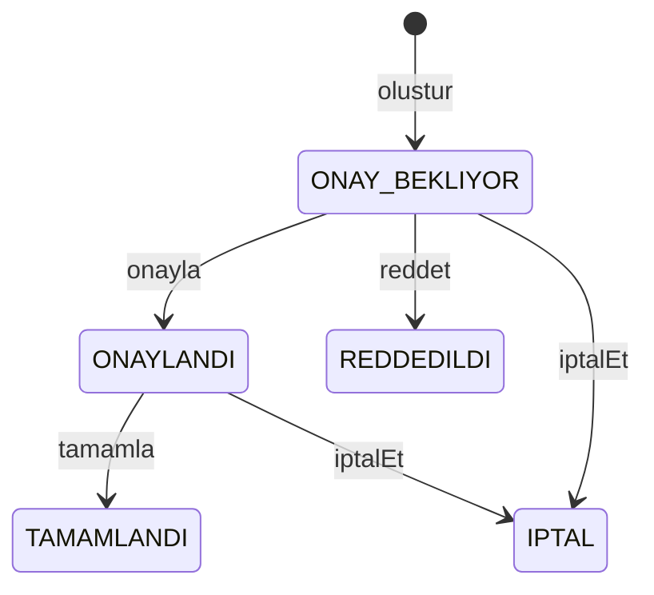

# Sunum notu

Süre: yaklaşık 5 dakika. Ekran, sınıf yapısını göstermek içindir.

## Ne gösterilecek

1. `SaglikKurumu` soyut sınıftır. `Hastane` ikinci şubeyi alır, `Klinik` almaz. Aynı `subeEkle` çağrısı iki farklı gövde çalıştırır.
2. `Kisi.rol()` her alt sınıfta sabittir. Giriş ekranı nesnenin sınıfına göre menü açar.
3. Randevu yalnızca `RandevuServisi` üzerinden doğar. Doktorun vermediği hizmet, uygunluk dışı saat, şube saati ve çakışma orada reddedilir. Doktor kendi uygunluk saatini menüden ekler; şube kapalıysa kayıt olmaz.
4. Durum geçişi `Randevu` içindedir. Onay bekleyen kayıt tamamlanamaz; reddedilen veya iptal edilen saat yeniden verilir.

## Sınıf diyagramı

Sunumda bu iki ağacı göstermek yeter. Ayrıntı `TASARIM.md` dosyasındadır.


`Hastane` ile `Klinik` farkı `yeniSubeKabulEder` gövdesindedir. Ekran farkı `OturumAcici` içindeki `instanceof` ayrımıdır.

## Durum geçişi



Sözlü cümle: talep onay bekler; doktor veya yönetici onaylar ya da reddeder; hasta da iptal edebilir. Tamamlama yalnızca onaydan sonra gelir.

## Ekran sırası

Program klasöründe `sistem.kayit` yoksa sunum dünyası kurulur. Varsa dosyayı silip yeniden açın.

```powershell
[Console]::OutputEncoding = [System.Text.Encoding]::UTF8
java -cp out com.mehdi8s.hastane.ekran.Uygulama
```

1. Selin Arslan: randevuları duruma göre listele. `1` onay bekleyen Özge’yi, `2` onaylı Ali’yi gösterir.
2. Kemal Aslan: onay listesinde yalnız Özge görünür. Ali zaten onaylı olduğu için bu listede yoktur.
3. Leyla Koç: şube eklemeyi deneyin. Klinik ikinci şubeyi reddeder.
4. Özge Çelik: ekranda Ayşe’nin uygun saati `Pazartesi 09:00-12:00` görünür. `2026-11-02 09:20` için yeni randevu alınır. `09:00` Ayşe’de doludur.

## Sınıf adları

Kod ASCII yazar (`SaglikKurumu`). Sözlü anlatımda Sağlık Kurumu, Şube, Randevu denir.
