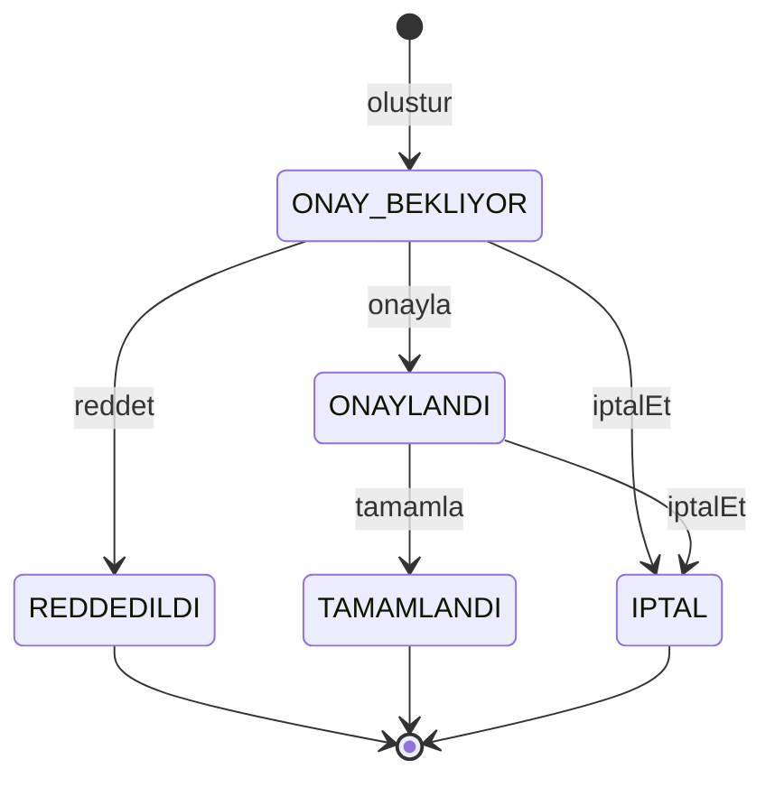
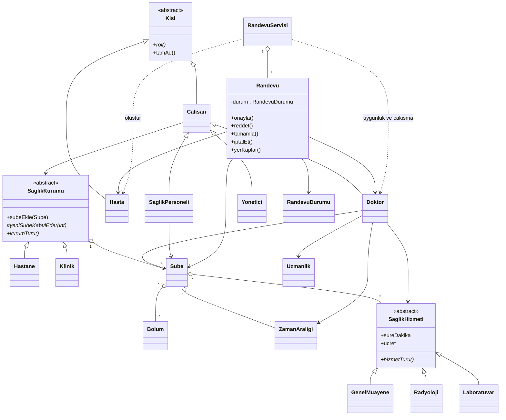
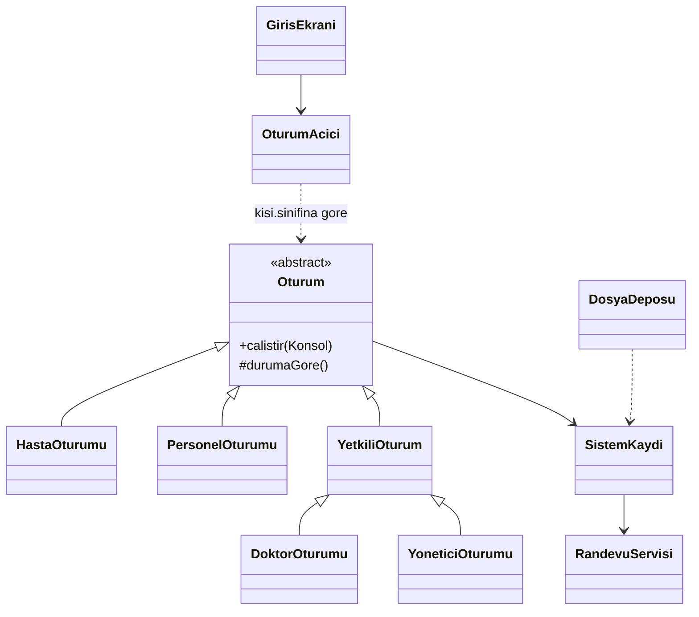

# Tasarım notu

## Amaç

Hastane ve klinik randevu sistemini nesnelere bölmek. Aynı sınıflar tek şubeli bir kliniği de, çok şubeli bir hastaneyi de taşır. Dil Java 17’dir. Erişim belirteçleri, soyut sınıf ve çok biçimlilik sunumda doğrudan gösterilebilir.

## Sınıflar

Dört grup vardır.

**Kurum.** `SaglikKurumu` soyut sınıftır. `Hastane` istediği kadar `Sube` alır. `Klinik` yalnızca bir şube kabul eder. Bu kural `yeniSubeKabulEder` metodunun iki farklı gövdesidir. Her şubenin bölümleri, çalışma saatleri ve hizmetleri vardır.

**Hizmet.** `SaglikHizmeti` süre ve ücret tutar. `GenelMuayene`, `Radyoloji` ve `Laboratuvar` kendi tür adını döndürür. Ücret ve süre sonradan değişmesin diye randevu bunları oluşturulduğu anda kopyalar.

**Kişi.** `Kisi` soyut sınıftır ve `rol()` her alt sınıfta sabittir: hasta, doktor, sağlık personeli, yönetici. Doktor ve personel bir şubeye bağlıdır. Yönetici kurumun tamamından sorumludur. Doktor yalnızca kendi şubesinde tanımlı hizmeti verebilir. Uygunluk aralığı, şubenin çalışma saatinin içinde olmak zorundadır.

**Randevu.** Yeni kayıt `ONAY_BEKLIYOR` durumundadır. Geçerli geçişler:

- onay bekliyor → onaylandı, reddedildi veya iptal
- onaylandı → tamamlandı veya iptal

Reddedilen, tamamlanan ve iptal edilen kayıt yeniden onaylanamaz. Saati dolduran durumlar onay bekleyen, onaylanan ve tamamlanandır; reddedilen ve iptal edilen saat yeniden verilebilir.

Ortak zaman kavramı `ZamanAraligi` içindedir. Şube çalışma saati ve doktor uygunluğu aynı sınıftır. Aralık aynı güne ait değilse çakışmaz. Bir aralık diğerini ancak aynı günde ve sınırların içindeyse kapsar.

## Sınıf diyagramı

Alan modeli üç kalıtım ağacı ve bir randevu servisi etrafında durur. `Hastane` ile `Klinik` aynı `subeEkle` çağrısını farklı yanıtlar. `DoktorOturumu` ile `YoneticiOturumu` aynı yetkili komutları paylaşır; gördükleri randevu listesi farklıdır.

## Randevu servisi

`RandevuServisi` yeni kaydın tek girişidir. Talep kabul edilmeden önce üç kural aranır:

- Başlangıç ve hizmet süresi, doktorun tek bir uygunluk aralığının içinde kalır. Aralık 09:00–12:00 ise 11:40’ta başlayan 20 dakikalık randevu geçer, 11:50’de başlayan geçmez.
- Aynı aralık şubenin çalışma saatinin de içinde kalır.
- Doktorun veya hastanın, saati hâlâ dolu olan başka bir randevusu yoktur. Dolu sayılan durumlar onay bekleyen, onaylanan ve tamamlanandır. Reddedilen ve iptal edilen saat yeniden verilebilir. Bitişik saatler çakışmaz: 09:00–09:20 ile 09:20–09:40 birlikte durabilir.

Onay, red ve tamamlama ilgili doktora veya aynı kurumun yöneticisine aittir. İptali randevunun hastası da yapabilir. Başka doktor, sağlık personeli ve başka kurumun yöneticisi bu kayda dokunamaz.

## Dosya deposu

`SistemKaydi` kurumları, kişileri ve randevu servisini bir arada tutar. `DosyaDeposu` bu kaydı UTF-8 metin dosyasına yazar ve açılışta aynı kimliklerle geri kurar. Hastane çok şubeli, klinik tek şubeli kalır; çünkü yüklenen nesne yine `Hastane` veya `Klinik` sınıfındandır. Randevunun onay, red ve iptal durumu da dosyada durur. İptal edilmiş saat yeniden verilebilir, onaylanmış saat dolu kalır.

Yeni nesne kendi kimliğini üretir. Dosyadan gelen nesne `yukle` metoduyla eski kimliğini korur. Böylece doktor, hasta ve randevu kapanıştan sonra da aynı kayıt olarak tanınır.

## Giriş ekranı

`GirisEkrani` kayıtlı kişileri listeler. `OturumAcici` seçilen nesnenin sınıfına göre oturum açar: `HastaOturumu`, `DoktorOturumu`, `YoneticiOturumu` veya `PersonelOturumu`. Doktor ve yönetici ortak komutları `YetkiliOturum` üzerinden alır; fark, gördükleri randevu listesindedir. Personelin onay komutu yoktur.

Hasta talebi, onay, red ve iptal yine `RandevuServisi` içinden geçer. Ekran kuralı tekrar etmez. İşlem kaydı değiştirirse `KayitSaklayici` dosyayı yeniden yazar.

## Yönetici tanımları

`YoneticiOturumu` kendi kurumuna şube, bölüm, çalışma saati ve hizmet ekler. Hastane ikinci şubeyi kabul eder; klinik `yeniSubeKabulEder` yüzünden reddeder. Yeni hizmet `GenelMuayene`, `Radyoloji` veya `Laboratuvar` olarak kurulur. Doktorun verdiği hizmet ve uygunluk da bu menüden yazılır. Doktor kendi uygunluğunu `DoktorOturumu` içinden de ekler. Aralık şubenin çalışma saatinin dışındaysa `Doktor` reddeder. Ekran bu kuralı yeniden yazmaz.

Aynı menüden hasta, doktor, personel ve ikinci yönetici kaydı da açılır. Yeni yönetici mevcut yöneticinin kurumuna bağlanır. Oturum kapanınca giriş ekranı onu da gösterir.

## Sunum senaryosu

`SunumSenaryosu` ilk açılışta hazır bir dünya kurar. `Şehir Hastanesi` iki şubelidir; `Mahalle Kliniği` tek şubede kalır. Hastanede iki yönetici vardır. Özge’nin randevusu onay bekler, Ali’nin randevusu onaylanmıştır. Klinik yöneticisi ikinci şube ekleyemez.

Liste komutu durum sorar: tümü, onay bekliyor, onaylandı, reddedildi, tamamlandı veya iptal. Onay, red, tamamlama ve iptal listeleri ise yalnız `Randevu` nesnesinin kabul ettiği geçişi gösterir. Onay bekleyen kayıt tamamlama listesine düşmez. Sunum sırası `SUNUM.md` dosyasındadır.

Sınıf adları ASCII yazılmıştır (`SaglikKurumu`). Sunumda bunlar Sağlık Kurumu olarak anlatılır. Türkçe karakterli dosya adından kaçınmak derlemeyi sade tutar. `Randevu` kurucusu durum geçişini bilir; saati ve yetkiyi servis denetler.
